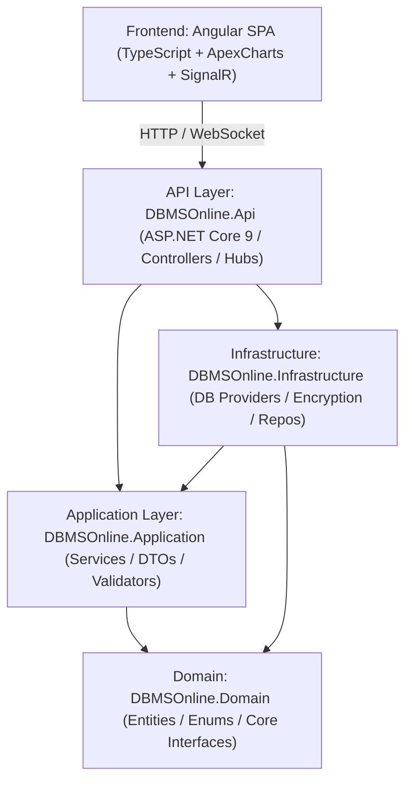

# ⚡ DBMSOnline Studio

> **Enterprise-Grade Multi-Engine Database Management & Visual Analytics Platform**  
> *Engineered with ASP.NET Core 9 (Clean Architecture) and Modern Angular SPA with Real-Time SignalR Streaming.*

[](https://dotnet.microsoft.com/)
[](https://angular.io/)
[](https://www.typescriptlang.org/)
[](https://dotnet.microsoft.com/apps/aspnet/signalr)
[](https://en.wikipedia.org/wiki/Galois/Counter_Mode)
[](LICENSE)

---

## 🌟 Overview

**DBMSOnline Studio** is a unified, cloud-ready web platform that transforms how engineering, DevOps, and business intelligence teams interact with heterogeneous database engines. Instead of requiring disparate client applications (such as SSMS, pgAdmin, MySQL Workbench, or DBeaver), DBMSOnline delivers a single, hardened web portal capable of querying, managing, visualizing, and backing up databases across on-premise and cloud infrastructures.

### Key Capabilities at a Glance

- **Multi-Engine Support**: Native provider abstraction for **PostgreSQL**, **Microsoft SQL Server**, **MySQL**, **SQLite**, **Oracle**, and **MongoDB**.
- **Interactive Multi-Tab SQL Editor**: Full syntax coloring, autocomplete suggestions, multi-tab execution, execution duration telemetry, and CSV/JSON export.
- **Static Query Safety Engine**: Pre-execution risk assessment categorizing queries into *Safe*, *Low*, *Moderate*, *High*, and *Critical* risk to prevent unintended drops, truncations, or table scans.
- **Reactive Data Grid**: In-browser record inspection, sorting, filtering, pagination, and direct row mutations (Add / Edit / Delete).
- **Interactive Schema & ER Diagram Canvas**: Real-time visualization of database tables, column types, primary keys, and foreign-key relationships.
- **PowerBI-Style Visual Analytics Engine**: Drag-and-drop dashboard creator with 30+ visual widgets (Bar, Column, Line, Area, Funnel, Waterfall, Treemap, Donut, Gauges, KPI Cards) with date hierarchy drill-down and aggregations (`SUM`, `AVG`, `COUNT`, `MIN`, `MAX`).
- **Enterprise Security & Compliance**:
  - **AES-256-GCM** authenticated credential and connection string encryption.
  - **SSRF Guard** to prevent internal network scanning and unauthorized localhost traversal.
  - **Dynamic PII & Sensitive Column Masking** (passwords, auth tokens, secrets).
  - **Immutable Security Audit Log** capturing client IP, timestamp, user role, engine target, and query execution hash.
- **Database Maintenance Suite**: Full database backup snapshots, restore workflows, CSV/JSON data import, and SQL dump export.
- **SignalR Real-Time Streaming**: Live execution status, progress notifications, and query execution cancellation.

---

## 📸 Screenshots & Visual Tour

### 1. Multi-Tab SQL Query Editor with Risk Telemetry
*Execute complex SQL scripts across different database engines with real-time performance metrics and AST risk profiling.*


### 2. Reactive Data Grid & Inline Record Mutations
*Explore tables with server-side pagination, sorting, column data types, primary key markers, and inline row editing.*


### 3. Interactive Schema & ER Diagram Visualizer
*Visual entity-relationship diagrams displaying schema structures, primary/foreign keys, and data types.*


### 4. Enterprise Security Audit Trail & Compliance Logging
*Comprehensive audit trail logging client IP, execution duration, rows affected, query text, and security risk levels.*


### 5. PowerBI-Inspired Visual Analytics & BI Engine
*Create multi-page executive dashboards with date hierarchy drill-downs, slicers, metrics, and over 30 chart types.*


### 6. Enterprise Admin Console & Role-Based Access Control (RBAC)
*Manage tenants, simulate user roles (SuperAdmin, OrgAdmin, DBA, Developer, Auditor), and inspect backup snapshots.*


### 7. Multi-Engine Connection Profile Manager
*Configure and test database connections with TLS/SSL enforcement and read-only safety locks.*


### 8. Database Snapshot Backup & Restoration Console
*Generate point-in-time snapshot backups and restore database states with one click.*


---

## 🏗️ Architecture & Technology Stack

DBMSOnline is architected using **Clean Onion Architecture** to ensure clean separation of concerns, high testability, and decoupled database providers via the **Strategy & Factory Patterns**.



### Technology Breakdown

| Component | Technology | Description |
|---|---|---|
| **Backend Core** | C# / .NET 9.0 & 10.0 Preview | High-performance asynchronous Web API |
| **Architecture** | Clean Onion Architecture | Domain, Application, Infrastructure, Presentation (API) |
| **Real-Time** | ASP.NET Core SignalR | Query streaming, real-time telemetry, and cancellation tokens |
| **Database Providers** | Strategy Pattern (`IDbProvider`) | PostgreSQL (Npgsql), MSSQL (Microsoft.Data.SqlClient), MySQL (MySqlConnector), SQLite (Microsoft.Data.Sqlite), Oracle, MongoDB |
| **Frontend UI** | Angular 18+ / 19 SPA | Modular Angular architecture, reactive forms, Datta-Able theme |
| **Visual Analytics** | ApexCharts & Custom BI Engine | 30+ chart types, field aggregation engine, date hierarchies |
| **Security & Crypto** | AES-256-GCM + SSRF Guard | Authenticated encryption for connection strings & credential store |
| **Data Validation** | FluentValidation | Strict DTO validation and input sanitization |

---

## 🚀 Getting Started

### Prerequisites

Ensure you have the following installed on your development machine:
- [.NET 9.0 SDK](https://dotnet.microsoft.com/download) (or higher)
- [Node.js](https://nodejs.org/) (v18.x, v20.x, or v22+)
- [npm](https://www.npmjs.com/) (v9.x or higher)
- Any supported database instance (PostgreSQL, SQL Server, MySQL) or use the included **Local SQLite Demo DB**.

---

### Step 1: Clone the Repository

```bash
git clone https://github.com/Anaszor/DBMSOnline.git
cd DBMSOnline
```

---

### Step 2: Backend Setup & Run

The backend is pre-configured with a SQLite metadata store and an embedded demo database (`demo_dbms.db`).

1. Navigate to the backend directory:
   ```bash
   cd backend/DBMSOnline.Api
   ```

2. Restore NuGet dependencies and build the solution:
   ```bash
   dotnet restore
   dotnet build
   ```

3. Run the backend API server:
   ```bash
   dotnet run
   ```

   The backend will start and listen on:
   - **Web UI & API**: `http://localhost:5123`
   - **Swagger OpenAPI Docs**: `http://localhost:5123/swagger`

> **Note**: The backend project is configured to serve the pre-built Angular SPA directly from `wwwroot`. Once running, navigating to `http://localhost:5123` will open the full application immediately!

---

### Step 3: Frontend Development Setup (Optional)

If you wish to modify or develop the Angular frontend:

1. Navigate to the frontend project directory:
   ```bash
   cd frontend/dbms-online-ui
   ```

2. Install npm dependencies:
   ```bash
   npm install
   ```

3. Run the Angular development server:
   ```bash
   npm start
   # Or: npx ng serve --port 4200
   ```

4. Open your browser at `http://localhost:4200`.

To build the frontend for production deployment into the backend's `wwwroot`:
```bash
npx ng build --output-path=../../backend/DBMSOnline.Api/wwwroot
```

---

## 🔒 Security Architecture

| Feature | Implementation | Purpose |
|---|---|---|
| **Credential Encryption** | `AesGcmEncryptionService` (AES-256-GCM) | Encrypts stored passwords and connection strings with authenticated tag verification. |
| **SSRF Guard** | `SsrfGuardService` | Validates hostnames and IP addresses against restricted loopbacks and internal cloud metadata endpoints. |
| **AST Query Safety** | `QuerySafetyEngine` | Parses SQL tokens prior to execution, detecting hazardous queries (unindexed deletes, truncate tables, Cartesian joins). |
| **Data Masking** | `MaskingService` | Automatically detects and masks sensitive columns (e.g. `Password`, `Token`, `Secret`, `SSN`) in query results. |
| **Audit Compliance** | `AuditLogger` & `AuditLogs` Table | Tracks every executed query, user role, client IP, execution duration, and query hash. |

---

## 📡 REST API Reference

The backend exposes a structured RESTful API documented via Swagger:

| Area | HTTP Method & Route | Description |
|---|---|---|
| **Connections** | `GET /api/connections` | Retrieve all saved database connection profiles. |
| | `POST /api/connections` | Create a new encrypted database connection profile. |
| | `POST /api/connections/test` | Test database connectivity before saving. |
| | `DELETE /api/connections/{id}` | Delete a saved database connection profile. |
| **Schema** | `GET /api/schema/databases/{id}` | List databases accessible on the connection. |
| | `GET /api/schema/tables/{id}` | List tables, schemas, and row count estimations. |
| | `GET /api/schema/columns/{id}` | List columns, data types, nullability, and keys. |
| | `GET /api/schema/relations/{id}` | List foreign-key relations for ER diagram generation. |
| **Queries** | `POST /api/query/execute` | Execute SQL queries with timeout and safety controls. |
| **Data Grid** | `POST /api/data/page` | Fetch paginated table data with sorting and filtering. |
| | `POST /api/data/mutate` | Insert, update, or delete an individual table row. |
| **Backup / Restore** | `POST /api/backuprestore/backup` | Create a full snapshot backup of a database. |
| | `POST /api/backuprestore/restore` | Restore a database state from a backup snapshot. |
| **Import / Export** | `POST /api/importexport/export-table` | Export table data to SQL, CSV, or JSON format. |
| | `POST /api/importexport/import-table` | Import CSV/JSON records into a target database table. |
| **Reporting & BI** | `GET /api/reporting/analytics` | Fetch telemetry metrics and dashboard analytics. |
| | `POST /api/reporting/reports` | Save or update custom BI report configurations. |
| **Audit Logs** | `GET /api/audit` | Fetch immutable security audit logs for compliance. |

---

## 👥 Authors & Acknowledgments

- **Lead Engineer & Architect**: **Anas Al-Zoriqi** ([@Anaszor](https://github.com/Anaszor))
- Built with modern open-source technologies: [.NET](https://github.com/dotnet/aspnetcore), [Angular](https://github.com/angular/angular), [Datta-Able](https://github.com/codedthemes/datta-able-free-angular-admin-template), and [ApexCharts](https://apexcharts.com/).

---

## 📄 License

This project is licensed under the **MIT License** - see the [LICENSE](LICENSE) file for details.
