# ⚡ DBMSOnline Studio

> **Cloud-Native, 100% Online Multi-Engine Database Management & Visual Analytics Platform**  
> *Connect to any database hosted anywhere in the cloud or on-premise directly from your browser. Engineered with ASP.NET Core 9 (Clean Architecture) and Modern Angular SPA with Real-Time SignalR Streaming.*

[](https://github.com/Anaszor/DBMSOnline)
[](https://dotnet.microsoft.com/)
[](https://angular.io/)
[](https://www.typescriptlang.org/)
[](https://dotnet.microsoft.com/apps/aspnet/signalr)
[](https://en.wikipedia.org/wiki/Galois/Counter_Mode)
[](LICENSE)

<p align="center">
  
  
  
  
  
  
</p>

---

## 🌟 Overview

**DBMSOnline Studio** is a modern, 100% web-based database management and business intelligence platform designed from the ground up for the cloud era. Unlike traditional desktop-bound tools (like SSMS, pgAdmin, Oracle SQL Developer, or DBeaver) that must be installed locally and often struggle across operating systems, DBMSOnline runs entirely in the browser. 

It provides an enterprise-ready single pane of glass allowing developers, DBAs, and data analysts to connect to, query, visualize, and back up **any database located anywhere in the world**—whether hosted on **AWS**, **Microsoft Azure**, **Google Cloud Platform**, **Render**, **Supabase**, **Neon**, **MongoDB Atlas**, **Oracle Cloud (OCI)**, private VPS servers, or local development instances.

---

## 🌐 100% Online & Multi-Database by Design

### 🌍 Connect Anywhere Online (Not Just Your Local Machine)
DBMSOnline is not limited to localhost or your internal network. You can securely connect to:
- **Cloud-Managed Databases**: AWS RDS, Azure SQL Database, GCP Cloud SQL, Render PostgreSQL, Supabase, Neon Serverless Postgres, PlanetScale, MongoDB Atlas.
- **Remote Servers & VPS**: Any remote Linux or Windows server hosting database services globally via custom ports, connection strings, and enforced TLS/SSL.
- **Hybrid & On-Premises**: Corporate data centers, private cloud clusters, and containerized database instances (Docker/Kubernetes).
- **Zero Local Client Footprint**: Access your entire database fleet from any laptop, desktop, tablet, or OS through any standard web browser without installing heavy database client packages or drivers.

### 🔀 Simultaneous Multi-Engine Database Connectivity
Manage, inspect, and switch between completely different database systems in real time within the **exact same workspace**:

| Engine | Deployment Scenarios Supported | Authentication Types |
|---|---|---|
| 🐘 **PostgreSQL** | Render Cloud, Supabase, Neon, AWS RDS, On-Prem | Password, SSL/TLS Certificates, Connection String |
| 🏢 **Microsoft SQL Server (MSSQL)** | Azure SQL, AWS RDS for SQL Server, On-Prem, Express | SQL Auth, Windows Integrated Auth, Encrypted Connection String |
| 🏛️ **Oracle Database** | Oracle Cloud Infrastructure (OCI), Autonomous DB, On-Prem 19c/21c | Standard Auth, TNS / Service Name, EZConnect |
| 🐬 **MySQL / MariaDB** | AWS Aurora MySQL, Google Cloud SQL, PlanetScale, DigitalOcean | Native Password, SSL CA/Cert, Connection String |
| 🍃 **MongoDB** | MongoDB Atlas Cloud, Self-Hosted Sharded Replica Sets | SCRAM-SHA-256, Mongo Connection Strings (mongodb+srv) |
| 🪶 **SQLite** | Local / Shared Volume Embedded Databases, Demo DBs | Direct File Storage & In-Memory Instances |

You can have a **PostgreSQL** cloud instance, an **Azure SQL Server**, an **Oracle production DB**, and a **MySQL cluster** active in your sidebar simultaneously, switching between them with a single click without disconnecting or reloading your session.

---

## 📸 Screenshots & Visual Tour

### 1. Multi-Tab SQL Query Editor with Risk Telemetry & Gemini Copilot Auto-Fix
*Execute complex SQL scripts across heterogeneous database engines with real-time performance metrics, AST risk profiling, and dynamic data masking. If a query fails due to dialect mismatches or column typos, the integrated **Gemini Copilot Autonomous Auto-Fix** instantly analyzes the error against the schema catalog and repairs the query with one click.*

#### Step 1: Autonomous Error Diagnosis & Dialect Auto-Fix Suggestion
*The user executes a query with a T-SQL dialect mismatch (`TOP 5`) and non-existent column (`Unit_Price`) against SQLite. The compiler rejects the query, and Gemini Copilot automatically diagnoses the failure, explaining the exact dialect and schema fix.*
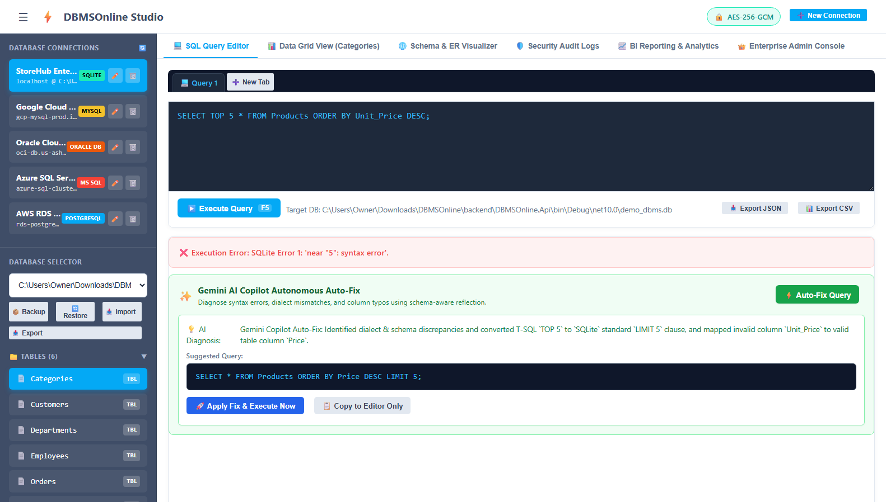

#### Step 2: Instant Execution Result After Applying Fix
*With one click on **Apply Fix & Execute Now**, the repaired query (`SELECT * FROM Products ORDER BY Price DESC LIMIT 5;`) executes immediately with sub-millisecond execution duration and real-time telemetry.*
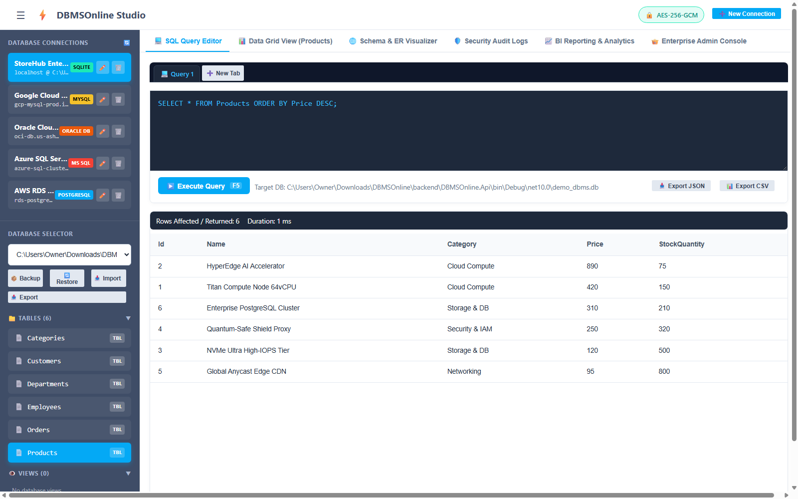

#### Step 3: Smart IntelliSense Auto-Suggest (Columns, Tables, Conditions & Keywords)
*As developers compose queries, the built-in SSMS-style IntelliSense engine actively introspects the active database schema catalog in real-time, providing categorized autocompletions with visual type badges for Table Columns (`[C]`), Primary Keys (`🔑 PK`), Foreign Keys (`🔗 FK`), Catalog Tables (`[T]`), SQL Condition Operators (`⚡ CONDITION`), and Dialect Clauses (`[K]`).*
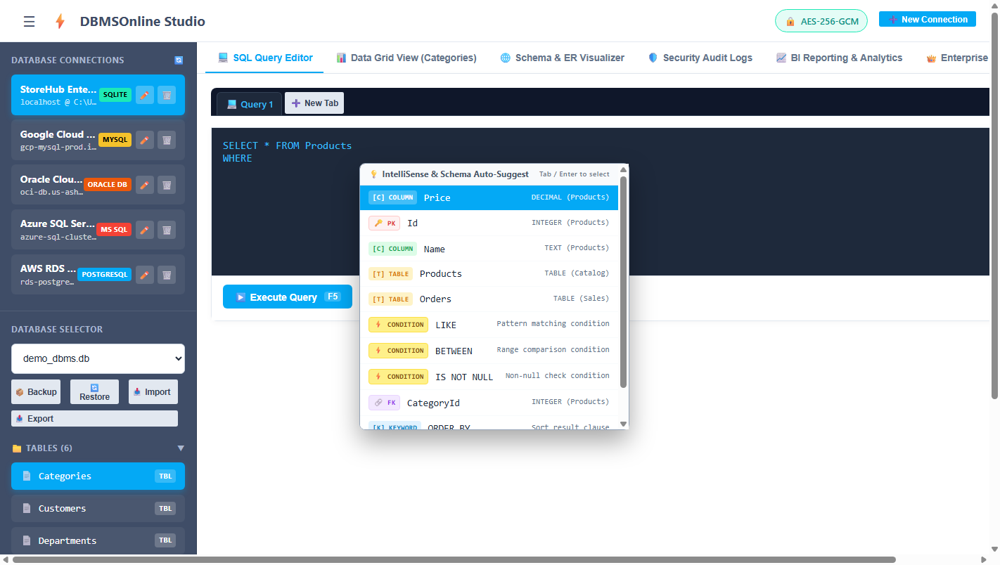

### 2. Reactive Data Grid & Inline Record Mutations
*Explore tables with server-side pagination, sorting, column data types, primary key markers, and inline row editing.*
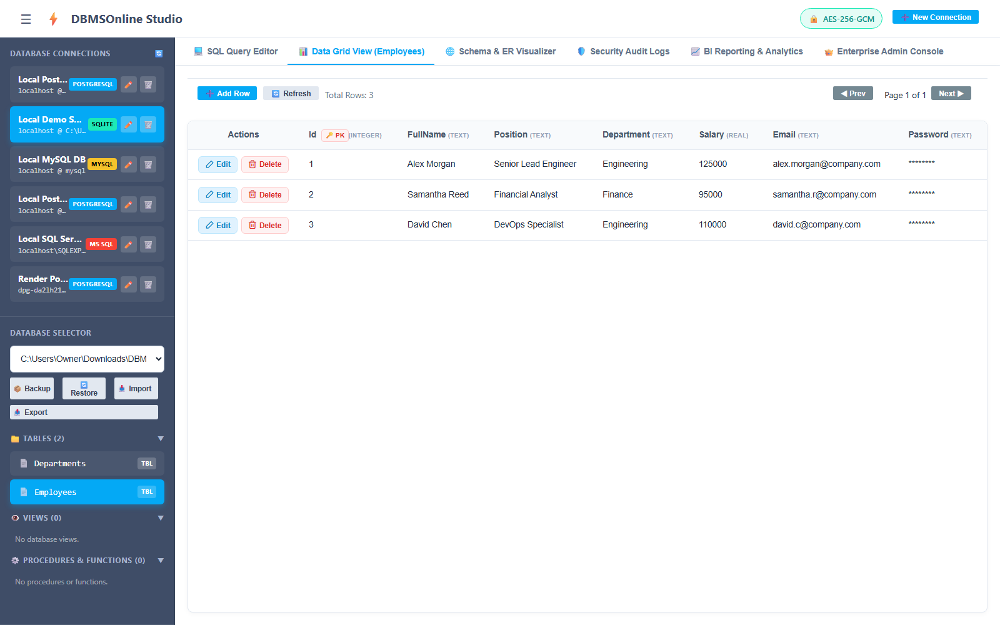

### 3. Interactive Schema & ER Diagram Visualizer
*Visual entity-relationship diagrams displaying schema structures, primary/foreign keys, and data types.*
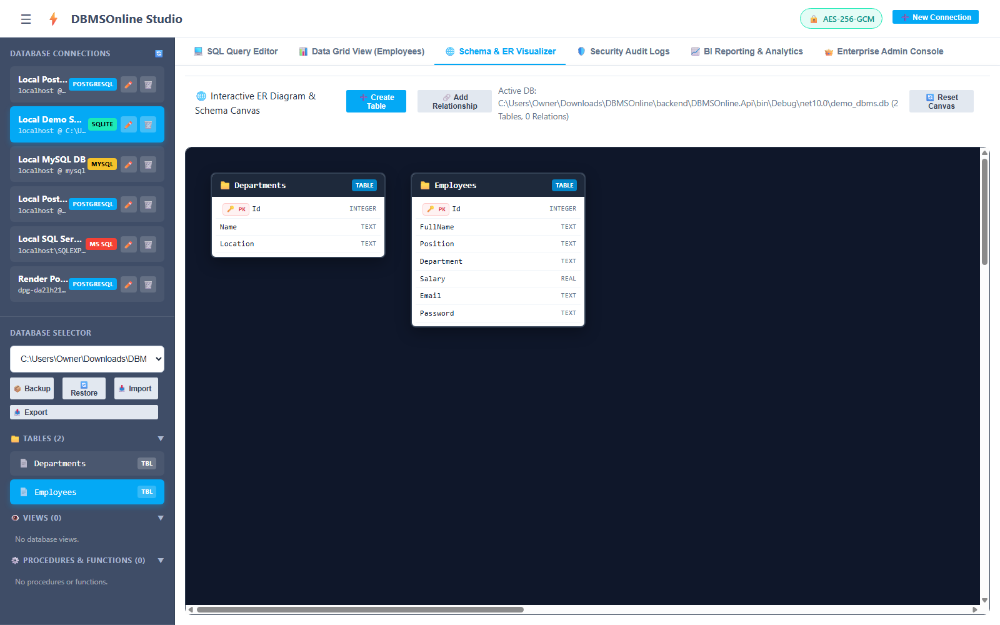

### 4. Enterprise Security Audit Trail & Compliance Logging
*Comprehensive audit trail logging client IP, execution duration, rows affected, query text, and security risk levels.*
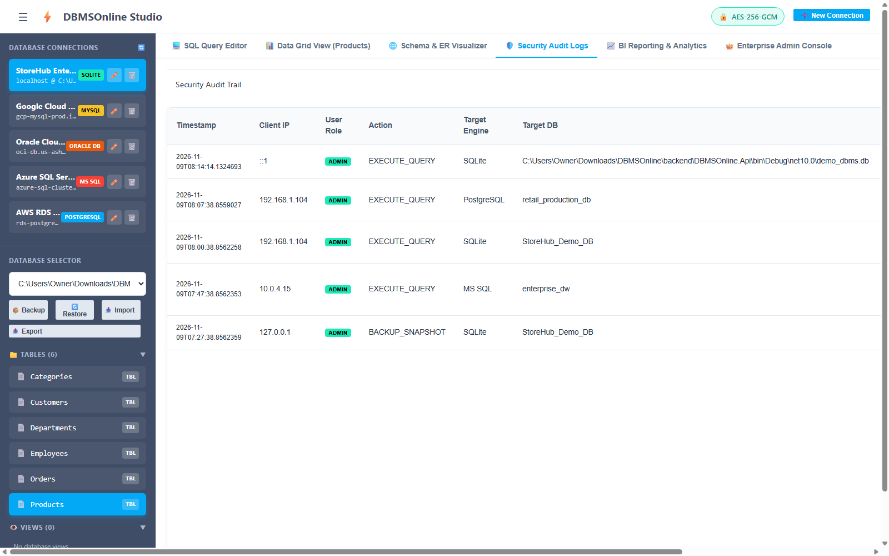

### 5. PowerBI-Inspired Visual Analytics & BI Engine
*Create multi-page executive dashboards with date hierarchy drill-downs, slicers, metrics, and over 30 chart types.*
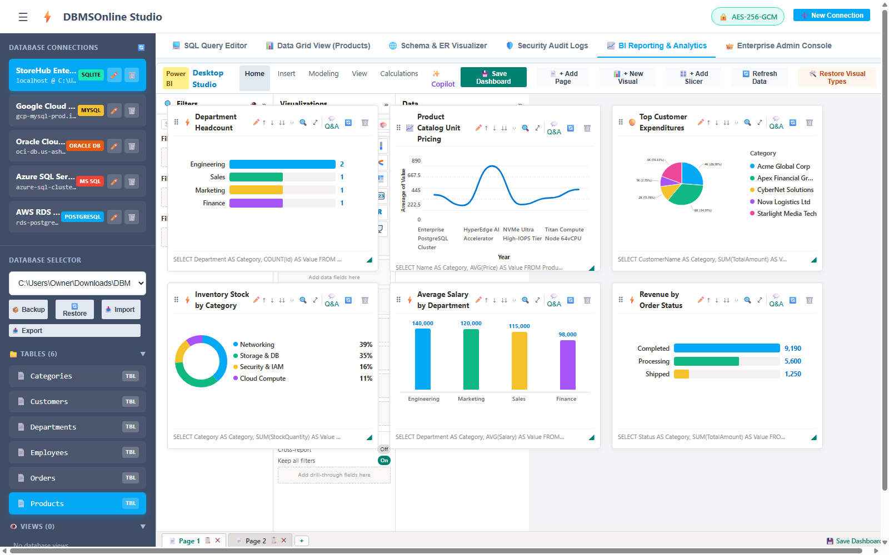

### 6. Enterprise Admin Console & Role-Based Access Control (RBAC)
*Manage tenants, simulate user roles (SuperAdmin, OrgAdmin, DBA, Developer, Auditor), and inspect backup snapshots.*
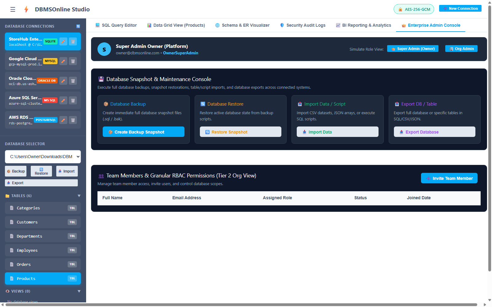

### 7. Multi-Engine Connection Profile Manager
*Configure and test database connections across PostgreSQL, MSSQL, Oracle, MySQL, SQLite, and MongoDB with TLS/SSL enforcement.*
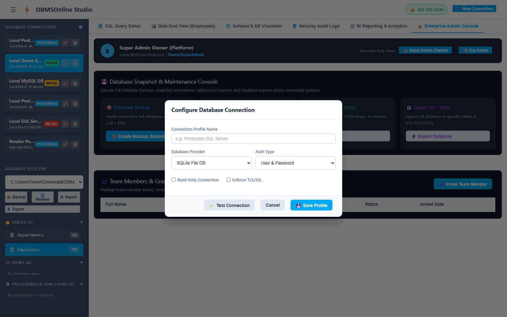

### 8. Database Snapshot Backup & Restoration Console
*Generate point-in-time snapshot backups and restore database states with one click.*
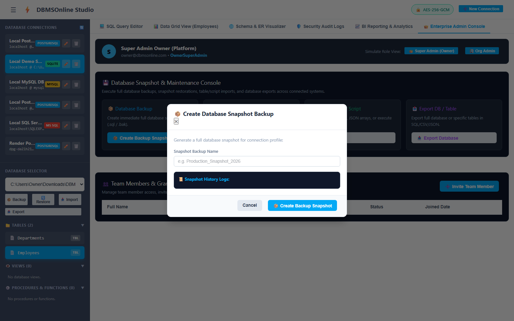

---

## 🏗️ Architecture & Technology Stack

DBMSOnline is architected using **Clean Onion Architecture** to ensure clean separation of concerns, high testability, and decoupled database providers via the **Strategy & Factory Patterns**.

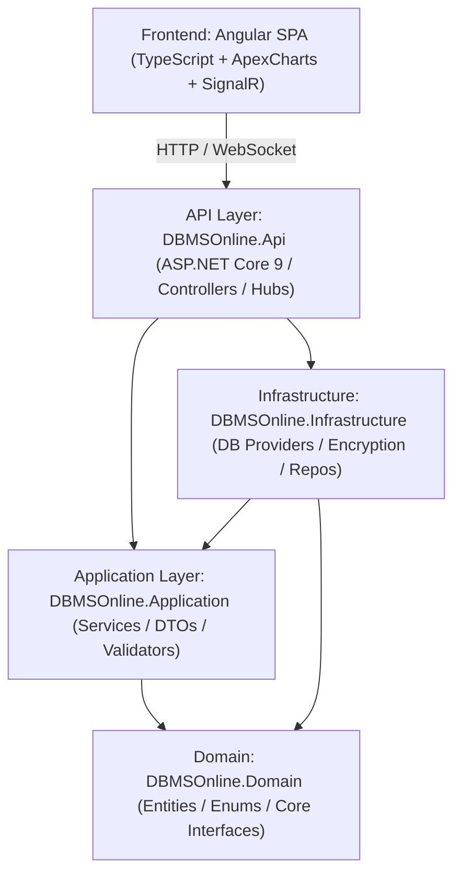

### Technology Breakdown

| Component | Technology | Description |
|---|---|---|
| **Backend Core** | C# / .NET 9.0 & 10.0 Preview | High-performance asynchronous Web API |
| **Architecture** | Clean Onion Architecture | Domain, Application, Infrastructure, Presentation (API) |
| **Real-Time** | ASP.NET Core SignalR | Query streaming, real-time telemetry, and cancellation tokens |
| **Database Providers** | Strategy Pattern (`IDbProvider`) | PostgreSQL (Npgsql), MSSQL (Microsoft.Data.SqlClient), MySQL (MySqlConnector), SQLite (Microsoft.Data.Sqlite), Oracle, MongoDB |
| **Frontend UI** | Angular 18+ / 19 SPA | Modular Angular architecture, reactive forms, Datta-Able theme |
| **Visual Analytics** | ApexCharts & Custom BI Engine | 30+ chart types, field aggregation engine, date hierarchies |
| **Security & Crypto** | AES-256-GCM + SSRF Guard | Authenticated encryption for connection strings & credential store |
| **Data Validation** | FluentValidation | Strict DTO validation and input sanitization |

---

## 🚀 Getting Started

### Prerequisites

Ensure you have the following installed on your development machine:
- [.NET 9.0 SDK](https://dotnet.microsoft.com/download) (or higher)
- [Node.js](https://nodejs.org/) (v18.x, v20.x, or v22+)
- [npm](https://www.npmjs.com/) (v9.x or higher)
- Any supported online or local database instance (PostgreSQL, SQL Server, Oracle, MySQL, MongoDB) or use the included **Local SQLite Demo DB**.

---

### Step 1: Clone the Repository

```bash
git clone https://github.com/Anaszor/DBMSOnline.git
cd DBMSOnline
```

---

### Step 2: Backend Setup & Run

The backend is pre-configured with a SQLite metadata store and an embedded demo database (`demo_dbms.db`).

1. Navigate to the backend directory:
   ```bash
   cd backend/DBMSOnline.Api
   ```

2. Restore NuGet dependencies and build the solution:
   ```bash
   dotnet restore
   dotnet build
   ```

3. Run the backend API server:
   ```bash
   dotnet run
   ```

   The backend will start and listen on:
   - **Web UI & API**: `http://localhost:5123`
   - **Swagger OpenAPI Docs**: `http://localhost:5123/swagger`

> **Note**: The backend project is configured to serve the pre-built Angular SPA directly from `wwwroot`. Once running, navigating to `http://localhost:5123` will open the full application immediately!

---

### Step 3: Frontend Development Setup (Optional)

If you wish to modify or develop the Angular frontend:

1. Navigate to the frontend project directory:
   ```bash
   cd frontend/dbms-online-ui
   ```

2. Install npm dependencies:
   ```bash
   npm install
   ```

3. Run the Angular development server:
   ```bash
   npm start
   # Or: npx ng serve --port 4200
   ```

4. Open your browser at `http://localhost:4200`.

To build the frontend for production deployment into the backend's `wwwroot`:
```bash
npx ng build --output-path=../../backend/DBMSOnline.Api/wwwroot
```

---

## 🔒 Security Architecture

| Feature | Implementation | Purpose |
|---|---|---|
| **Credential Encryption** | `AesGcmEncryptionService` (AES-256-GCM) | Encrypts stored passwords and connection strings with authenticated tag verification. |
| **SSRF Guard** | `SsrfGuardService` | Validates hostnames and IP addresses against restricted loopbacks and internal cloud metadata endpoints. |
| **AST Query Safety** | `QuerySafetyEngine` | Parses SQL tokens prior to execution, detecting hazardous queries (unindexed deletes, truncate tables, Cartesian joins). |
| **Data Masking** | `MaskingService` | Automatically detects and masks sensitive columns (e.g. `Password`, `Token`, `Secret`, `SSN`) in query results. |
| **Audit Compliance** | `AuditLogger` & `AuditLogs` Table | Tracks every executed query, user role, client IP, execution duration, and query hash. |

---

## 📡 REST API Reference

The backend exposes a structured RESTful API documented via Swagger:

| Area | HTTP Method & Route | Description |
|---|---|---|
| **Connections** | `GET /api/connections` | Retrieve all saved database connection profiles. |
| | `POST /api/connections` | Create a new encrypted database connection profile. |
| | `POST /api/connections/test` | Test database connectivity before saving. |
| | `DELETE /api/connections/{id}` | Delete a saved database connection profile. |
| **Schema** | `GET /api/schema/databases/{id}` | List databases accessible on the connection. |
| | `GET /api/schema/tables/{id}` | List tables, schemas, and row count estimations. |
| | `GET /api/schema/columns/{id}` | List columns, data types, nullability, and keys. |
| | `GET /api/schema/relations/{id}` | List foreign-key relations for ER diagram generation. |
| **Queries** | `POST /api/query/execute` | Execute SQL queries with timeout and safety controls. |
| **Data Grid** | `POST /api/data/page` | Fetch paginated table data with sorting and filtering. |
| | `POST /api/data/mutate` | Insert, update, or delete an individual table row. |
| **Backup / Restore** | `POST /api/backuprestore/backup` | Create a full snapshot backup of a database. |
| | `POST /api/backuprestore/restore` | Restore a database state from a backup snapshot. |
| **Import / Export** | `POST /api/importexport/export-table` | Export table data to SQL, CSV, or JSON format. |
| | `POST /api/importexport/import-table` | Import CSV/JSON records into a target database table. |
| **Reporting & BI** | `GET /api/reporting/analytics` | Fetch telemetry metrics and dashboard analytics. |
| | `POST /api/reporting/reports` | Save or update custom BI report configurations. |
| **Audit Logs** | `GET /api/audit` | Fetch immutable security audit logs for compliance. |

---

## 👥 Authors & Acknowledgments

- **Lead Engineer & Architect**: **Anas Al-Zoriqi** ([@Anaszor](https://github.com/Anaszor))
- Built with modern open-source technologies: [.NET](https://github.com/dotnet/aspnetcore), [Angular](https://github.com/angular/angular), [Datta-Able](https://github.com/codedthemes/datta-able-free-angular-admin-template), and [ApexCharts](https://apexcharts.com/).

---

## 📄 License

This project is licensed under the **MIT License** - see the [LICENSE](LICENSE) file for details.
